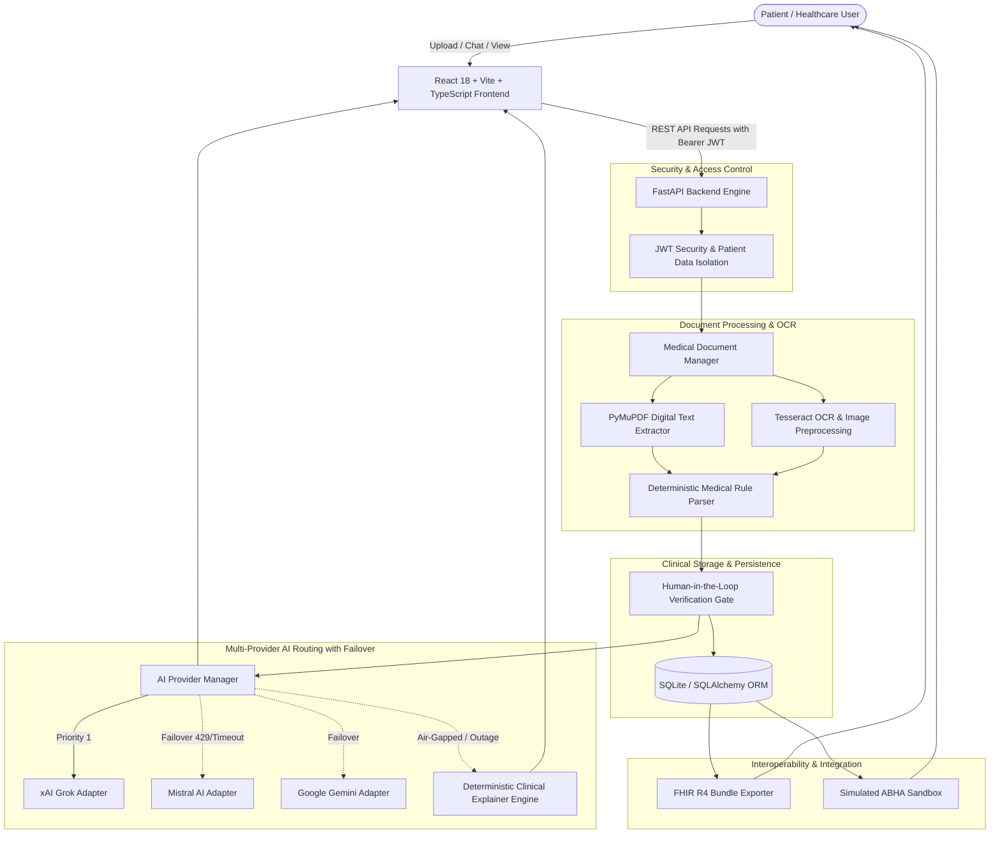
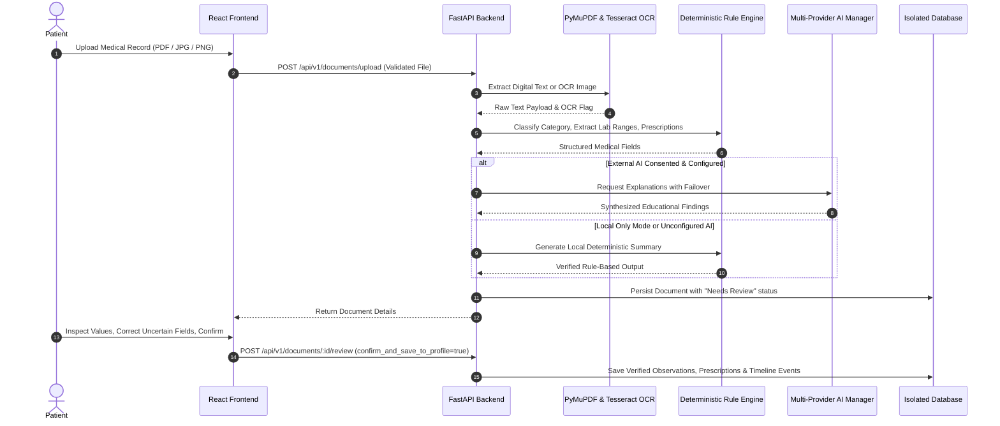

# AI-Powered Personal Health Copilot — Architecture & Technical Specifications

**Exact Project Identity:** AI-Powered Personal Health Copilot  
**Subtitle:** A Multilingual Platform for Intelligent Medical Record Analysis, Personalized Health Profiles, and Healthcare Journey Management.

---

## 1. High-Level System Architecture

---

## 2. Medical Document Processing & OCR Workflow

---

## 3. Multi-Provider AI Routing & Circuit Breaker Logic

The AI Provider Manager routes requests strictly in the following priority order:
1. **xAI Grok** (`grok-beta`)
2. **Mistral AI** (`mistral-small-latest`)
3. **Google Gemini** (`gemini-1.5-flash`)
4. **Local Deterministic Fallback** (Rules engine with zero external network dependencies)

### Failover & Circuit Breaker Protocol:
- **HTTP 429 (Rate Limits) / 5xx / Network Timeouts:** Automatically trigger failover to the next eligible provider without duplicating non-idempotent operations.
- **Circuit Breaker:** After 3 consecutive provider failures, the provider's circuit opens for 60 seconds (cooldown). Subsequent requests bypass it immediately to reduce latency.
- **Privacy & Consent Gate:** If the user enables "Local-Processing Mode" or revokes external AI consent, the multi-provider system is completely bypassed. Medical records stay entirely on-premises.

---

## 4. FHIR R4 Interoperability & Simulated ABHA Profile

- **FHIR R4 Alignment:** Generates standard `Bundle` (type: `collection`) with valid `Patient`, `Observation`, `MedicationStatement`, and `DocumentReference` clinical representations.
- **Simulated ABHA Profile:** Fully functional sandbox workflow allowing patients to link simulated 14-digit ABHA health numbers (e.g. `91-XXXX-XXXX-XXXX`) and addresses. Prominently labeled with sandbox disclaimers.
